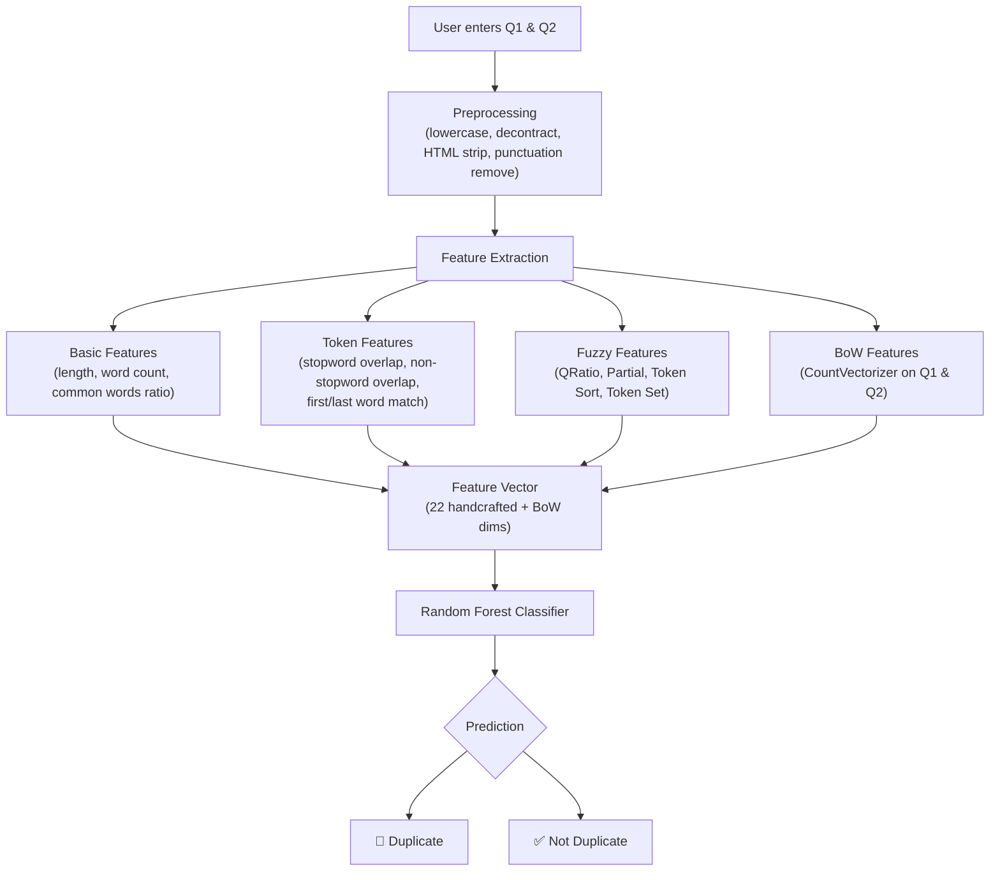

# 🔍 Duplicate Question Pair Detector

> A Machine Learning web app that detects whether two questions are **semantically duplicate** — built on the Quora Question Pairs dataset with a Streamlit frontend.


---

## 📸 Demo

| Input | Result |
|-------|--------|
| *"What is the best way to learn Python?"* vs *"How can I learn Python effectively?"* | 🔁 **Duplicate** |
| *"How do I make pizza?"* vs *"What is the capital of France?"* | ✅ **Not Duplicate** |

---

## 📁 Project Structure

```
Duplicate-question-pair/
│
├── app.py                              # Streamlit frontend (main entry point)
├── helper.py                           # Feature engineering & preprocessing
├── model.pkl                           # Trained Random Forest model
├── cv.pkl                              # Fitted CountVectorizer (BoW)
├── train.csv                           # Quora Question Pairs dataset
├── bow_preprocessed_advanceFeature.ipynb  # Training & EDA notebook
├── requirements.txt                    # Python dependencies
└── README.md                           # This file
```

---

## ⚙️ How It Works



---

## 🧠 Feature Engineering

The model uses **3 categories** of handcrafted features + Bag-of-Words:

### 1. Basic Features (7)
| Feature | Description |
|---------|-------------|
| `q1_len` | Character length of Q1 |
| `q2_len` | Character length of Q2 |
| `q1_num_words` | Word count of Q1 |
| `q2_num_words` | Word count of Q2 |
| `common_words` | Count of words shared between Q1 & Q2 |
| `total_words` | Total unique words across both questions |
| `word_share` | `common_words / total_words` |

### 2. Token Features (8)
| Feature | Description |
|---------|-------------|
| `cwc_min` | Common non-stopwords / min(non-stopwords in Q1, Q2) |
| `cwc_max` | Common non-stopwords / max(non-stopwords in Q1, Q2) |
| `csc_min` | Common stopwords / min(stopwords in Q1, Q2) |
| `csc_max` | Common stopwords / max(stopwords in Q1, Q2) |
| `ctc_min` | Common tokens / min(tokens in Q1, Q2) |
| `ctc_max` | Common tokens / max(tokens in Q1, Q2) |
| `last_word_eq` | 1 if last words match, else 0 |
| `first_word_eq` | 1 if first words match, else 0 |

### 3. Fuzzy Features (4)
| Feature | Description |
|---------|-------------|
| `fuzz_ratio` | Overall string similarity |
| `fuzz_partial_ratio` | Partial substring similarity |
| `token_sort_ratio` | Similarity after sorting tokens alphabetically |
| `token_set_ratio` | Similarity using set-based token matching |

### 4. Length Features (3)
| Feature | Description |
|---------|-------------|
| `abs_len_diff` | Absolute difference in token counts |
| `mean_len` | Average token length of both questions |
| `longest_substr_ratio` | Longest common substring / min(len(Q1), len(Q2)) |

### 5. Bag-of-Words
Both Q1 and Q2 are independently transformed using a **CountVectorizer** and concatenated to the feature vector.

---

## 🚀 Getting Started

### Prerequisites
- Python 3.9+
- pip

### 1. Clone the repository
```bash
git clone https://github.com/your-username/duplicate-question-pair.git
cd duplicate-question-pair
```

### 2. Install dependencies
```bash
pip install -r requirements.txt
```

> **Tip:** Install `python-Levenshtein` for faster fuzzy matching:
> ```bash
> pip install python-Levenshtein
> ```

### 3. Run the app
```bash
streamlit run app.py
```

The app will open at **http://localhost:8501** in your browser.

---

## 📦 Dependencies

```
streamlit
scikit-learn
nltk
fuzzywuzzy
distance
beautifulsoup4
pandas
numpy
joblib
```

---

## 📊 Dataset

**Quora Question Pairs** — originally from [Kaggle](https://www.kaggle.com/c/quora-question-pairs)

| Stat | Value |
|------|-------|
| Total pairs | ~404,000 |
| Duplicate pairs | ~37% |
| Non-duplicate pairs | ~63% |
| Features used | Text (question1, question2), is_duplicate label |

---

## 🤖 Model

| Property | Detail |
|----------|--------|
| Algorithm | Random Forest Classifier |
| Vectorizer | CountVectorizer (Bag-of-Words) |
| Training file | `bow_preprocessed_advanceFeature.ipynb` |
| Serialization | `pickle` (`.pkl`) |

### Known Limitations
- **No semantic understanding** — "ML" and "Machine Learning" are treated as different words
- **BoW loses word order** — context and sentence structure are ignored  
- **Vocabulary mismatch** — synonyms ("keen to learn" vs "interested in learning") score low similarity
- **sklearn version warning** — model was trained on `sklearn 1.6.1`; re-train if upgrading

> For better semantic accuracy, consider upgrading to a **Sentence-BERT** or **TF-IDF + cosine similarity** approach.

---

## 🌐 App Features

- 🎨 Dark gradient UI with glassmorphism design
- 📝 Multi-line text inputs for longer questions
- 🔁 / ✅ Color-coded result banners with confidence scores
- 📊 Feature breakdown panel (fuzzy scores, word overlap, chips)
- 💡 Sidebar with example question pairs
- ⚠️ Input validation and error handling
- ⚡ Cached model loading with `@st.cache_resource`

---

## 🗺️ Roadmap

- [ ] Upgrade to TF-IDF + cosine similarity baseline
- [ ] Add Sentence-BERT / semantic embedding model
- [ ] Show side-by-side word diff highlighting
- [ ] Batch prediction via CSV upload
- [ ] Deploy to Streamlit Cloud / Hugging Face Spaces

---

## 📄 License

This project is licensed under the **MIT License** — see the [LICENSE](LICENSE) file for details.

---

## 🙏 Acknowledgements

- [Quora Question Pairs — Kaggle](https://www.kaggle.com/c/quora-question-pairs)
- [FuzzyWuzzy](https://github.com/seatgeek/fuzzywuzzy)
- [Streamlit](https://streamlit.io)
- [scikit-learn](https://scikit-learn.org)

